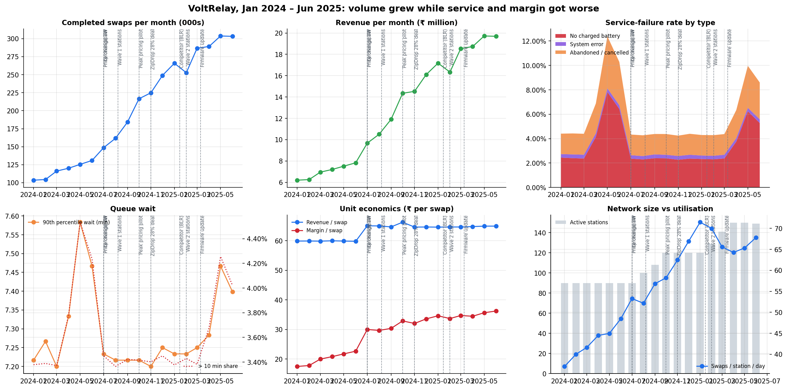
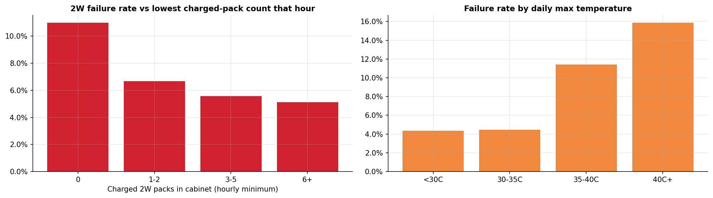
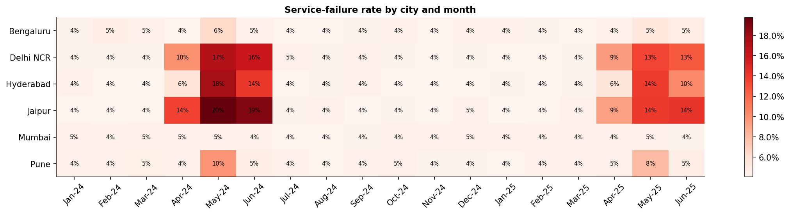
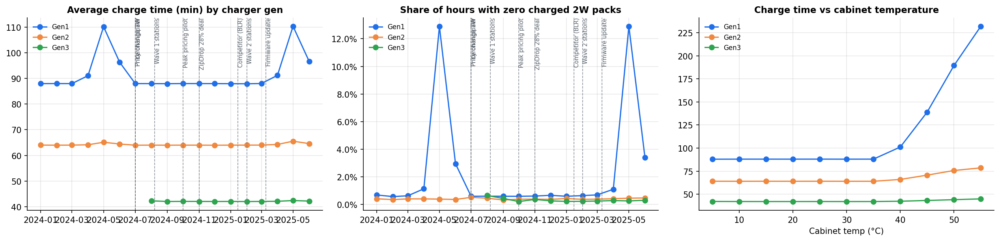
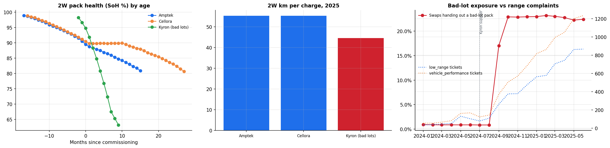
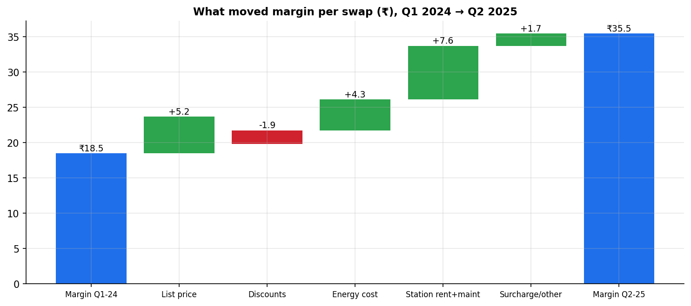
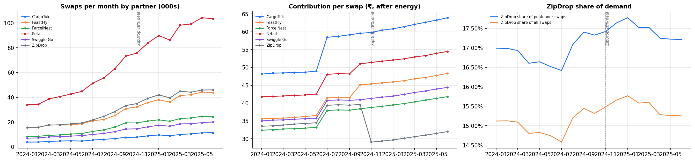
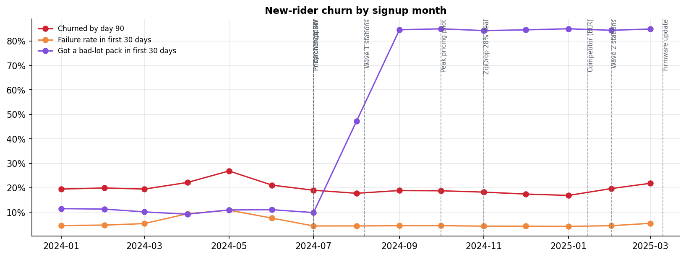

# VoltRelay Energy: what is really behind the drop in service, retention and margin

**Data Analytics Hackathon, Gradient Learnings · Period analysed: Jan 2024 to Jun 2025 · 3.81M swap attempts, 150 stations, 6 cities**

---

## Executive summary

Swaps grew 2.8× (from 108k to 299k a month) and monthly revenue tripled (from ₹6.5M to ₹19.4M). Over the same period, the service-failure rate almost doubled, from 4.4% in Q1 2024 to 8.3% in Q2 2025. Of the six business changes, our analysis points to three root causes. Two of the changes leadership was worried about are not causes.

| # | Root cause | Evidence | Hurts |
|---|---|---|---|
| 1 | **Old Gen1 chargers fail in summer heat.** Above about 40°C cabinet temperature they charge 2–2.6× slower, cabinets run out of charged packs, and riders are turned away. | Gen1 stations fail 12.7% of attempts vs 5.1–6.6% elsewhere (Apr–Jun 2025). Failure rate is 15.9% on 40°C+ days vs 4.4% below 35°C. | Service, **new-rider churn** |
| 2 | **Bad battery batch from the new supplier.** Kyron lots KY-2407/08/09 (1,461 packs) lost health far faster than other lots. | 61% average health vs 81% for other suppliers. 19% less range per charge. 2.6× more range complaints. ₹4.79 crore of packs retired at once. | Margin (asset loss), rider experience |
| 3 | **ZipDrop contract amendment.** Discount went from 12% to 28%, with no peak surcharge. | Contribution per ZipDrop swap fell 25% (₹39.5 → ₹29.6). ZipDrop volume grew only as fast as the network. ₹36.4 lakh of extra discount in 8 months. | Margin |

**Ruled out:** the station expansion waves (new Gen2/Gen3 stations perform best), the July 2024 price rise (volume kept growing), firmware updates and poor connectivity (system errors flat at 0.3%), and the Bengaluru competitor (no measurable effect on churn).

**Where to spend the next budget:** (1) replace or cool the Gen1 chargers in Jaipur, Hyderabad and Delhi NCR before April; (2) recover the cost of the bad battery lots from Kyron and add lot-level acceptance testing; (3) renegotiate ZipDrop to tie the extra discount to off-peak usage; (4) protect new riders' first 30 days.

> **A note on "shrinking margin".** If we count only energy and station rent/maintenance, margin per swap rose from ₹18.4 to ₹35.5 because stations got busier (40 → 66 swaps/station/day) and prices rose in July 2024. The margin squeeze leadership sees comes from two things that this per-swap view hides: the **ZipDrop discount** (revenue per swap fell from ₹66.3 to ₹64.6 in Nov 2024 and has not recovered) and the **Kyron write-off** (₹4.79 crore, which equals ₹18.6 for every swap served from Sep 2024 to Jun 2025, more than half of today's operating margin).

---

## 1. Problem and approach

VoltRelay runs unmanned battery-swap cabinets for 2W/3W delivery riders. In the 18 months analysed, five business changes overlapped with the decline: two expansion waves (Aug–Oct 2024, Feb–Apr 2025), a price rise (Jul 2024), a peak/off-peak pricing pilot (Bengaluru and Pune, from Oct 2024), a new battery supplier (Kyron, from Jul 2024) and a new ZipDrop contract (Nov 2024). Because they overlap, a simple before/after view cannot separate them. For each change we compared **segments that were exposed with segments that were not**: Gen1 vs Gen2/3 stations, bad-lot vs other batteries, pilot vs non-pilot cities, ZipDrop vs the rest of the network.

Tools: Python, DuckDB (SQL), pandas, statsmodels and matplotlib in Google Colab. Notebook: [`notebooks/voltrelay_analysis.ipynb`](../notebooks/voltrelay_analysis.ipynb).

## 2. Data cleaning

All 8 tables loaded completely (3,877,013 swap rows, 0 lines lost). Every fix is logged in [`outputs/tables/dq_log.csv`](../outputs/tables/dq_log.csv). The main ones:

| Issue | Rows | Action |
|---|---|---|
| Swaps at two **test stations** (STN-TST-01/02) | 62,031 | Removed. Also removed 535 tickets and 26,256 hourly rows at these stations |
| Re-synced duplicate swaps (same rider, station and time, or same battery pair) | 87 | Removed |
| Negative km since last swap / over 200 km on one charge (sensor errors) | 7,814 / 7,712 | Set to missing |
| Battery health or charge above 100% | 6,069 / 3,698 | Capped at 100% |
| Rider city spelled 15 extra ways (BLR, Bombay, Gurgaon, "bengaluru ", …) | 585 | Mapped to the 6 cities |
| Duplicate tickets / tickets outside the period | 937 / 86 | Removed |
| Typos in ticket comments (staion, battry, rnage) | 4,512 | Fixed |
| **"other" tickets that describe weak vehicles or low range** | 9,484 | Re-tagged as `vehicle_performance`. Confirmed: 33.5% involve a bad-lot pack, the same as `low_range` (34.0%) and far above billing (10.1%) |
| 1,438 batteries "retired, end_of_life" on the same day while under 1 year old | 1,438 | Treated as a recall (section 6) |

Result: 3,814,897 clean swap attempts.

## 3. Q1 Trends

| Metric (monthly average) | Q1 2024 | Q2 2025 | Change |
|---|---|---|---|
| Completed swaps | 108k | 299k | 2.8× |
| Revenue | ₹6.5M | ₹19.4M | 3.0× |
| Service-failure rate | 4.4% | 8.3% | +3.9 pts |
| "No charged battery" failures | 2.4% | 5.1% | 2.1× |
| Waits over 10 minutes | 3.4% | 4.0% | +0.6 pts |
| Revenue per swap | ₹59.9 | ₹64.9 | +₹5.0 |
| Discount per swap | ₹4.6 | ₹6.5 | +₹1.9 |
| Operating margin per swap (after energy, rent, maintenance) | ₹18.4 | ₹35.5 | +₹17.1 |
| Swaps per station per day | 40 | 66 | +66% |

**Failures are seasonal, not a steady decline.** The failure rate jumped to 12.4% in May 2024 and 10.0% in May 2025, and stayed at about 4.3% in every month in between. The rise in the "Q2 2025 vs Q1 2024" comparison is a summer effect. Queues are not the main issue: the 90th-percentile wait moved only from 7.2 to 7.6 minutes. Riders fail because **no charged battery is available**.

## 4. Q2 Where and when failures happen

- **Heat:** failure rate is 4.4% below 35°C, 11.4% at 35–40°C and 15.9% above 40°C. On heat-alert days it is 16.0% vs 5.5%.
- **Charged inventory:** in hours when a cabinet hit zero charged 2W packs, 11.0% of attempts failed, vs 5.1% when 6 or more were ready.
- **City:** the hot cities are worst: Jaipur 7.8%, Delhi NCR 7.4%, Hyderabad 6.7%, vs Mumbai 4.4% and Bengaluru 4.6%.
- **Vehicle:** 3W riders fail 2–2.5× more than 2W riders (9.2% vs 3.8% in Jan 2024, and 15.9% vs 11.9% in May 2024).
- **Hour of day:** a small effect (6.1% at peak vs 5.6% off-peak).
- **No effect:** rain, floods, e-commerce sales, holidays and competitor promotions.

## 5. Q3 Stations

**Gen1 chargers are the bottleneck.** All 51 Gen1 stations are from the Launch wave. Charge time is a flat 88 minutes up to about 35°C cabinet temperature, then rises to 139 minutes at 45°C, 190 at 50°C and 232 at 55°C. At 50°C, 82% of Gen1 hours have zero charged packs. Gen2 slows only to 76 minutes, and Gen3 stays at about 44 minutes.

| Apr–Jun 2025 | Stations | Swaps/day | Failure rate | Hours with 0 charged packs | Avg monthly profit |
|---|---|---|---|---|---|
| Launch, Gen1 | 51 | 70.2 | **12.7%** | **5.9%** | ₹76k |
| Launch, Gen2 | 39 | 65.6 | 5.6% | 0.4% | ₹71k |
| Wave 1, Gen2 | 23 | 53.5 | 6.6% | 0.5% | ₹53k |
| Wave 1, Gen3 | 7 | 60.4 | 5.1% | 0.2% | ₹68k |
| Wave 2, Gen3 | 30 | 72.5 | 5.1% | 0.3% | ₹82k |

- **Gen1 is concentrated in the hot cities:** Jaipur 10 of 18 stations, Hyderabad 13/26, Delhi NCR 13/30, vs Mumbai 2/22, Pune 4/22 and Bengaluru 9/32. This explains the city ranking above.
- **The expansion is not the problem.** New Gen3 stations have the lowest failure rate and the highest profit. All 150 stations cover their energy, rent and maintenance. Launch stations in zones that received new stations still grew 45%, so we see no sign that the new stations took their volume. The comparison group of zones without new stations is small (3 stations).
- **Location:** the busiest sites (commercial hubs 9.1%, markets 8.6%) fail most, and highway fuel pumps fail least (6.4%).
- **Firmware and connectivity:** system errors are flat at 0.3% in every month and every connectivity tier. Stations with fair/poor connectivity sync 45% of events offline, without more failures.

## 6. Q4 Batteries

- **Kyron**, the new supplier since Jul 2024, made 3 bad lots (KY-2407/08/09, 1,461 packs, 89% of all Kyron packs). Their health averages **61%**, vs 81% for Cellora and Amptek packs, many of which have been in service longer.
- In 2025, a bad-lot 2W pack delivered **44.6 km per charge vs 55.4 km** for other packs (−19%). The worst 10% of trips managed only 34 km.
- Range and vehicle complaints run at **6.2 per 1,000 swaps** for bad-lot packs vs 2.4 for Cellora (2.6×).
- From Sep 2024, **23% of all swaps handed a rider a bad-lot pack**.
- 1,438 of these packs were retired on one day (15 Jun 2025), labelled "end_of_life". Their purchase value is **₹4.79 crore**. Supplier cost per kWh is the same for all three suppliers, so Kyron was not even cheaper.
- Ageing of the other suppliers' packs is normal and is not a cause.
- Likely side effect (not proven): 19% less range means riders need about 24% more swaps per km, which adds load on stations at peak.

## 7. Q5 Pricing and fleet contracts

**Margin bridge (₹ per swap, Q1 2024 → Q2 2025):** 18.5 + 5.2 (higher list price) − 1.9 (more discount) + 4.3 (lower energy per swap) + 7.6 (rent and maintenance spread over more swaps) + 1.7 (peak surcharge/other) = 35.5.

- **Price rise (Jul 2024, 2W ₹60 → ₹65, 3W ₹100 → ₹110):** added about ₹5 per swap. Volume kept growing (131k in June → 149k in July), so there was no visible demand loss.
- **Peak/off-peak pilot (Bengaluru, Pune, from Oct 2024):** retail riders paid ₹7.8 more per swap (₹67.5 → ₹75.3) with no change in failure rate. However, the share of swaps at peak hours fell only from 74.1% to 72.5%, and was unchanged in other cities. The "peak" window covers 13 of 24 hours, which is too broad to move demand.
- **ZipDrop (largest partner, 15% of swaps):** since 1 Nov 2024 it gets 28% instead of 12% and pays no peak surcharge.
  - Discount per swap rose from ₹8.1 to ₹18.9, and contribution per swap fell from ₹39.5 to ₹29.6 (−25%).
  - ZipDrop volume grew 44% (Jul–Oct vs Nov–Feb), about the same as the whole network (+40%). The extra discount did not buy extra volume.
  - 87% of ZipDrop swaps happen at peak hours, the time the network is most stretched.
  - Extra discount vs the old deal: **₹36.4 lakh on 336k swaps in 8 months** (about ₹55 lakh a year at the current rate). This accounts for about ₹1.6 of the ₹1.9 rise in network discount per swap.

## 8. Q6 Why new riders churn

**Definition:** 12,740 riders who signed up between Jan 2024 and Mar 2025. A rider counts as churned if they had no completed swap in days 61–90 after signup. Overall churn is **19.6%**.

Churn follows the summer failure spikes: 19.5% for Q1 2024 cohorts, **26.9% for the May 2024 cohort**, 17–19% in autumn, and up to 21.8% for the Mar 2025 cohort (whose first months were Apr–Jun 2025). Riders who signed up in Apr–Jun churn 23.4%, vs 18.8% for other months.

**Primary reason: failed swaps in the first month.** Among riders with 5 or more attempts, churn rises steadily with their first-month failure rate:

| First-30-day failure rate | Riders | Churned by day 90 |
|---|---|---|
| 0–5% | 3,712 | 10.7% |
| 5–10% | 3,031 | 18.4% |
| 10–20% | 1,764 | 26.0% |
| over 20% | 438 | **39.5%** |

Riders whose first-month failure rate was above 10% churn at 28.9%, vs 16.2% for everyone else, which is about 260 extra lost riders. When the failures are "no charged battery", riders above 10% churn at 34.8%.

**Secondary reasons:**
- 3W riders churn 22.9% vs 19.0% for 2W (3W failure rates are about twice as high).
- Riders onboarded by fleet partners churn 21.1% vs 16.9% for app-store signups. Partner-billed plans churn 20.7% vs 16.8% for prepaid.
- Riders whose home station is Gen1 churn 20.2% vs 17.5% for Gen3.
- Low early engagement: riders with fewer than 20 attempts in month 1 churn at 48–63%. About 42% of all churners are in this group.

**Not drivers:** bad-lot batteries (these riders do not churn more; they complain more), the competitor near Bengaluru stations (odds ratio 1.11, p = 0.46), the ZipDrop contract, the expansion wave of the home station, and support tickets.

*Method note:* simple "had at least one failure" flags pointed the wrong way, because heavy users naturally meet more failures but also stay. Measuring the failure **rate** per attempt removes this bias. The logistic-regression output is in `outputs/tables/q6_churn_drivers_adjusted.csv`.

## 9. Where to spend the next budget

| Priority | Action | Why (evidence) | Expected effect |
|---|---|---|---|
| **1** | **Replace Gen1 chargers with Gen3, starting with the 36 Gen1 stations in Jaipur, Hyderabad and Delhi NCR, before April 2026.** Until then, add cabinet cooling/shade and raise charged-pack targets from April. | Gen1 fails 12.7% vs 5.1% for Gen3. Charge time 2.2× at 50°C. Gen1 handles about 36% of attempts. | Summer failure rate from ~8.3% to about 5.8%, about 25k fewer failed swaps per summer quarter, and lower new-rider churn (up to ~260 riders per 15 months are linked to high first-month failure) |
| **2** | **Claim recall/warranty compensation from Kyron for lots KY-2407/08/09. Test the capacity of a sample from every new lot before deployment. Track health by lot after 90 days.** | 1,461 packs at 61% health, 19% less range, 2.6× complaints, ₹4.79 crore retired. | Recover part of ₹4.79 crore and stop the next bad lot within weeks instead of 11 months |
| **3** | **Renegotiate ZipDrop:** keep 12% as the base rate and give the extra discount only for off-peak swaps or volume above an agreed baseline. Reinstate the peak surcharge. | Contribution −25% with no extra volume. 87% of its swaps at peak. | Recover up to ~₹55 lakh a year and move some demand off-peak |
| **4** | **Protect the first 30 days:** steer new riders to Gen2/Gen3 stations, show live charged-pack counts in the app, and give an automatic credit after a failed swap. Focus on 3W and partner-onboarded riders. | Churn rises from 10.7% to 39.5% as first-month failures rise. | Lower new-rider churn, especially in summer cohorts |
| **5** | **Narrow the peak pricing window** to the real crunch hours, increase the off-peak discount, and use it in hot cities during summer. | Pilot added ₹7.8 per retail swap but moved only 1.6 pts of demand. | Keep the extra revenue while actually shifting load |
| **6** | **Add 3W slots and inventory** at stations with high 3W demand. | 3W failure 2–2.5× 2W, and 3W churn is higher. | Fewer 3W failures |

**Do not spend on:** more expansion just to fix service (expansion isn't the cause), firmware or connectivity projects (no effect on failures), or a competitor response in Bengaluru (no measurable effect).

## 10. Limitations

- These are observational comparisons, not experiments. Where we could, we compared exposed and unexposed groups over the same period.
- Margin here covers energy, station rent and maintenance only. Battery depreciation, staff and overheads are not in the dataset.
- "Peak hours" are the hours where the PEAK tariff applies (06–08, 12–17, 19–22).
- The cannibalisation check has a small comparison group (3 stations).
- The title of the trend chart says margin got worse. As explained above, that holds only once partner discounts and battery losses are counted.

## AI disclosure

AI tools (Kiro) helped write the analysis code, check data quality and draft this report. The team ran every query on the organizer dataset in Google Colab and reviewed the results. All numbers come from `outputs/tables/`.
